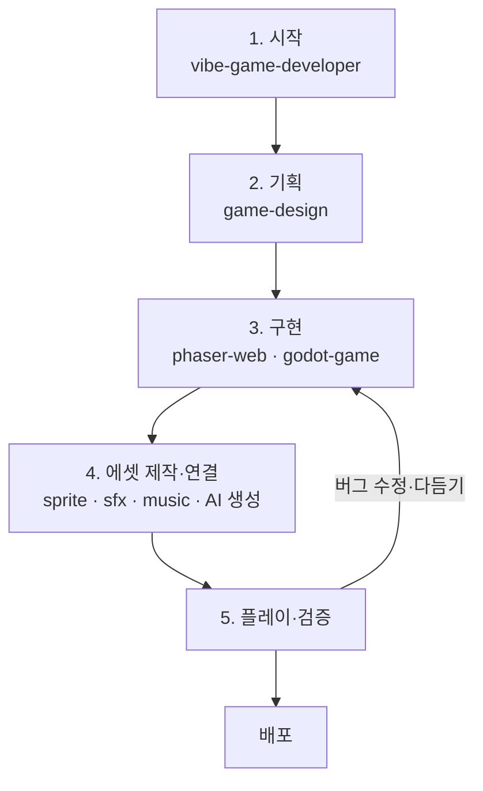

# Game Dev Studio (`agy-game-studio`)

**Game Dev Studio**는 [Google Antigravity](https://antigravity.google)에서 [Phaser](https://phaser.io/) 웹 게임과 [Godot](https://godotengine.org/) 모바일·PC 게임을 만드는 플러그인입니다. 버전 `0.4.0`에는 **게임 개발·미디어 스킬 10개**, Python이나 `uv` 없이 동작하는 **10개 도구의 Go MCP 서버**(`game-studio`), Phaser 게임용 **Game Dev Studio Playtest UI**(최근 10초 DVR 되감기, 버그 주석, GIF 캡처)가 들어 있습니다.

게임 프로젝트를 열고 `/vibe-game-developer`에 만들고 싶은 게임을 설명하면, 프로젝트 템플릿에 맞는 스킬로 기획과 구현을 시작할 수 있습니다.


> [!NOTE]
> 이 저장소는 Daniela Petruzalek의 [danicat/agy-game-studio](https://github.com/danicat/agy-game-studio)(Go·Ebitengine 대상)를 Phaser Web과 Godot 템플릿용으로 바꾼 포크입니다. README의 스크린샷은 원본 버전에서 찍은 화면이라 실제 패널과 조금 다를 수 있습니다.

---

## 지원하는 게임 템플릿

| 템플릿 | 대상 | 저장소 |
| :--- | :--- | :--- |
| Phaser Web | 브라우저 게임 (standalone · CrazyGames) | [harpuria/phaser-web-template](https://github.com/harpuria/phaser-web-template) |
| Godot Mobile | Android · iOS 게임 | [harpuria/godot-mobile-template](https://github.com/harpuria/godot-mobile-template) |
| Godot PC | 데스크톱 · Steam Deck 게임 | [harpuria/godot-pc-template](https://github.com/harpuria/godot-pc-template) |

새 게임은 각 템플릿의 `docs/template/APPLYING.md`에 따라 생성합니다. 기존 게임은 해당 저장소를 Antigravity에서 바로 엽니다.

---

## 사용자 설치 (User-Level Installation)

`agy-game-studio`는 미리 빌드된 UI 에셋(`dist/`)을 포함하고 있으며, Antigravity에 내장된 Node.js 런타임과 `sidecar_sdk`를 사용합니다. 사용자로 설치할 때는 **`npm install`이 필요 없고**, **프론트엔드 빌드 단계도 없으며**, **Python이나 `uv`도 설치하지 않습니다**. 번들된 Go MCP 서버(`mcp/`)를 필요할 때 빌드하기 위한 Go 툴체인(`1.26` 이상)만 있으면 됩니다.

게임 자체를 실행하는 데 필요한 도구는 템플릿마다 다릅니다.

| 대상 | 필요 도구 |
| :--- | :--- |
| 플러그인 (MCP 서버) | Go `1.26+` |
| Phaser Web 게임 | Node.js `22.12+`, npm (게임 저장소의 `.nvmrc` 기준) |
| Godot Mobile · PC 게임 | Godot `4.7.2` Standard (템플릿에 고정된 버전) |

### 선택 사항: Gemini 및 Vertex AI 인증 정보

절차적 오디오(`.music`, `.sfx`), 절차적 스프라이트 또는 `.aseprite` 스프라이트, 스프라이트 정규화, Phaser 플레이테스트는 모두 오프라인에서 동작합니다. `game-studio` MCP 도구의 **`image_generate`**(Nano Banana)와 **`music_generate`**(Lyria)로 생성형 AI 에셋을 만들려면 다음 두 가지 Google Gen AI 인증 방식 중 하나를 설정합니다.

- **방법 1: Vertex AI / Gemini Enterprise (Application Default Credentials)**

  ```bash
  gcloud auth application-default login
  export GOOGLE_CLOUD_PROJECT="your-gcp-project-id"
  export GOOGLE_CLOUD_LOCATION="global"
  export GOOGLE_GENAI_USE_ENTERPRISE="true" # 또는 GOOGLE_GENAI_USE_VERTEXAI="true"
  ```

- **방법 2: Gemini Developer API (API 키)**

  ```bash
  export GEMINI_API_KEY="your-api-key" # 또는 GOOGLE_API_KEY
  ```

### 1. 플러그인 설치

사용하는 Antigravity 환경에 맞는 설치 방법을 선택합니다.

#### Antigravity CLI (`agy`)

셸에서 GitHub 저장소로 바로 설치합니다.

```bash
agy plugin install https://github.com/harpuria/agy-game-studio
```

또는 대화형 `agy` TUI 세션 안에서 `/plugin`으로 설치합니다.

```text
/plugin install https://github.com/harpuria/agy-game-studio
```

#### Antigravity 2.0 및 Antigravity IDE

플러그인 디렉터리를 Antigravity의 플러그인 탐색 경로 중 한 곳에 두거나 심볼릭 링크로 연결합니다.

- **전역 (모든 워크스페이스)**
  - **macOS / Linux**: `~/.gemini/config/plugins/agy-game-studio`
  - **Windows**: `%USERPROFILE%\.gemini\config\plugins\agy-game-studio`

  ```bash
  git clone https://github.com/harpuria/agy-game-studio.git ~/.gemini/config/plugins/agy-game-studio
  ```

- **로컬 체크아웃 심볼릭 링크 (로컬 개발·테스트에 권장)**
  원하는 위치에 클론한 뒤 작업 트리를 전역 플러그인 폴더에 연결하면, Antigravity가 체크아웃에서 수정 사항을 바로 읽습니다. 자세한 내용은 아래 [개발자·기여자 가이드](#개발자기여자-가이드)를 참고하세요.

  ```bash
  ln -s /path/to/agy-game-studio ~/.gemini/config/plugins/agy-game-studio
  ```

- **워크스페이스 (프로젝트 단위)**
  저장소 루트의 `.agents/plugins/agy-game-studio`에 플러그인을 두거나, 상위 디렉터리를 `.agents/plugins.json`(워크스페이스) 또는 `~/.gemini/config/plugins.json`(전역)에 등록합니다.

  ```json
  {
    "entries": [
      { "path": "/path/to/plugins" }
    ]
  }
  ```

### 2. 플러그인 활성화

1. 디스크에 플러그인 디렉터리를 직접 만들거나 심볼릭 링크로 연결했다면, Antigravity가 시작할 때 디렉터리를 찾을 수 있도록 **Antigravity를 재시작**합니다.
2. **Antigravity 2.0** 또는 **Antigravity IDE**의 왼쪽 사이드바에서 **Customizations**를 열고 **Installed** 탭에서 **Game Dev Studio**(`agy-game-studio`)가 활성화됐는지 확인합니다. (채팅에서 `/plugin`을 실행하거나 CLI에서 `agy plugin enable agy-game-studio`를 실행해도 됩니다.)
3. 활성화되면 Antigravity가 `agy-game-studio/studio` 사이드카 프로세스와 `game-studio` stdio MCP 서버(`mcp_config.json`)를 자동으로 시작하고 관리합니다.

### 3. Game Dev Studio 열기 및 환경 확인

Antigravity 대화에서 `/game-dev-studio`를 입력하면 **Game Dev Studio** 사이드 패널(`sidecar://agy-game-studio/studio/playtest`)이 열립니다. 대화 오른쪽 위의 **⋮ → Extensions → Game Dev Studio**로도 열 수 있습니다.

- **Phaser 게임 연결**: 게임 루트에서 `node /path/to/agy-game-studio/scripts/playtest-phaser.mjs`를 실행하고, 터미널에 표시된 로컬 주소를 패널에 입력한 뒤 **▶ Connect to game**을 누릅니다. 자세한 절차는 [Playtest 확장](#game-dev-studio-playtest-확장-sidecarsstudio)을 참고하세요.

`./scripts/check_env.sh [studio|mcp|phaser|godot]`로 언제든 환경을 확인할 수 있습니다(`--help`로 사용법 확인).

| 명령 | 확인 내용 |
| :--- | :--- |
| `./scripts/check_env.sh studio` | 패널 런타임용 Node.js |
| `./scripts/check_env.sh mcp` | MCP 서버용 Node.js와 Go 툴체인, Go 모듈 |
| `./scripts/check_env.sh phaser` | Phaser 템플릿용 Node.js `22.12+`와 npm |
| `./scripts/check_env.sh godot` | Godot `4.7.2` Standard (PATH 밖의 엔진은 `GODOT` 환경 변수로 지정) |

---

## 게임 하나를 만드는 순서



1. **템플릿을 선택하고 라우터로 시작합니다 (`vibe-game-developer`).** 브라우저 게임은 Phaser Web, Android·iOS 게임은 Godot Mobile, 데스크톱 게임은 Godot PC로 시작합니다. ([지원하는 게임 템플릿](#지원하는-게임-템플릿))
2. **첫 장면의 목표를 정합니다 (`game-design`).** 채팅에 `/vibe-game-developer Phaser로 30초 동안 별을 모으는 게임을 만들고 싶어. 이동 조작과 한 판이 끝나는 조건부터 정리해 줘.`처럼 요청합니다. 합의한 규칙은 Phaser의 `docs/game/GDD.md`, Godot의 `docs/GDD.md`에 기록합니다.
3. **한 판을 끝까지 구현합니다 (`phaser-web` · `godot-game`).** 이동 → 별 획득 → 점수 표시 → 시간 종료까지 연결합니다. Phaser는 `src/game/`, Godot는 `game/`에 게임 규칙을 두고, 저장·입력·오디오는 템플릿이 제공하는 기능을 사용합니다.
4. **필요한 에셋을 만들어 붙입니다 (`nano-banana` · `sprite-design` · `procedural-sfx` · `procedural-music` · `lyria`).** “별을 주웠을 때 짧은 효과음을 만들어 연결해 줘”처럼 게임 안에서 언제 쓰이는지 설명하면 MCP 도구로 PNG·WAV를 굽고 장면에 연결합니다.
5. **플레이하고 검증한 뒤 배포합니다 (`game-dev-studio` · `phaser-web` · `godot-game`).** 아래 [실행과 검증](#실행과-검증) 방법으로 조작과 피드백을 확인하고, Phaser는 Playtest 패널로 버그 장면을 캡처해 대화에 첨부하면서 반복 개선합니다.

---

## 실행과 검증

아래 명령은 **게임 저장소의 루트**에서 실행합니다.

| 대상 | 플레이 | 변경 후 검증 |
| :--- | :--- | :--- |
| Phaser Web | 처음에 `npm ci`, 이후 `npm run dev:standalone` | `npm run check`. UI·입력을 수정했다면 `npm run test:e2e` |
| Godot Mobile | Godot에서 `project.godot`를 열고 **F5** (또는 `godot --path .`) | [모바일 통합 검사](skills/godot-game/references/mobile.md)를 실행하고 터치·광고·결제는 실기기에서 확인 |
| Godot PC | Godot에서 `project.godot`를 열고 **F5** (또는 `godot --path .`) | `bash tools/validate.sh`를 실행하고 배포 빌드는 대상 OS에서 확인 |

배포 빌드는 Phaser의 경우 자체 호스팅은 `npm run build:standalone`, CrazyGames 제출은 `npm run build:crazygames`를 사용합니다. Godot는 각 템플릿의 export preset과 [모바일](skills/godot-game/references/mobile.md)·[PC](skills/godot-game/references/pc.md) 절차를 따릅니다.

---

## Game Dev Studio Playtest 확장 (`sidecars/studio`)

`/game-dev-studio`, `[Game Dev Studio](sidecar://agy-game-studio/studio/playtest)`, 또는 **⋮ → Extensions → Game Dev Studio**로 오른쪽 보조 패널에서 **Game Dev Studio**를 엽니다. Playtest 패널은 **Phaser Web** 게임을 대상으로 합니다. Godot 게임은 템플릿의 네이티브 실행과 테스트 경로로 검증합니다.

- **Phaser 게임 연결**: Phaser 게임 루트에서 `npm ci`로 의존성을 설치한 뒤 `node /path/to/agy-game-studio/scripts/playtest-phaser.mjs`를 실행합니다(경로는 플러그인의 실제 설치 경로로 바꿉니다). 이 스크립트는 게임 자체의 Vite 설정을 standalone 모드로 띄우면서 캡처 브리지 스크립트(`server/services/phaser-bridge.js`)를 주입합니다. 터미널에 출력된 로컬 주소를 패널에 입력하고 **▶ Connect to game**을 누릅니다.
- **10초 DVR 링 버퍼**: 게임 화면의 최근 **10초(25 FPS 기준 250 프레임)**를 계속 기록합니다.
- **일시정지, 탐색, 주석 (`F8` 또는 `` ` ``)**: 게임을 멈추고 10초 DVR 타임라인을 프레임 단위로 탐색하며, 시각적 버그 위에 박스·화살표·메모를 그린 뒤 다음 중 하나를 현재 대화에 보냅니다.
  - **📸 Frame**: 주석이 포함된 PNG 스크린샷과 게임 콘솔 로그
  - **🎞️ 10s GIF**: 게임 화면 해상도에 맞춘 최근 10초 분량의 애니메이션 GIF와 게임 콘솔 로그
- 테스트가 끝나면 시작한 Vite 프로세스를 종료합니다.


### 내보낸 10초 DVR 게임플레이 GIF


---

## 번들 스킬 (10개)

게임 개발·미디어 스킬 10개는 각각의 상세 `references/` 가이드와 함께 `skills/` 안에 들어 있습니다. 스킬별 `scripts/` 디렉터리 대신 하나의 번들 Go MCP 서버(`mcp/`)를 사용하므로 Python이나 `uv` 런타임이 필요하지 않습니다.

| 스킬 | 분야 | 쓰는 때 |
| :--- | :--- | :--- |
| [`vibe-game-developer`](skills/vibe-game-developer/SKILL.md) | 워크플로 라우터 | 프로젝트의 템플릿(Phaser Web · Godot Mobile · Godot PC)을 확인하고 기획·구현·에셋·검증 작업에 맞는 스킬을 선택할 때 |
| [`game-design`](skills/game-design/SKILL.md) | 게임 디자인 | 한 번에 한 가지씩 결정하는 인터뷰로 플레이어의 목표, 조작, 반복 행동, 승패 조건을 정하고 게임 문서를 작성할 때 |
| [`phaser-web`](skills/phaser-web/SKILL.md) | Phaser 웹 | Phaser 장면·웹 입력·에셋 로딩을 구현하고 standalone·CrazyGames 빌드를 검증할 때 |
| [`godot-game`](skills/godot-game/SKILL.md) | Godot 모바일·PC | GDScript 장면·저장·입력·오디오를 구현하고 모바일 광고·결제 또는 PC 입력·창 설정을 연결할 때 |
| [`sprite-design`](skills/sprite-design/SKILL.md) | 2D 스프라이트·애니메이션 | 절차적 `.sprite` DSL, `.aseprite` 파일, 시트 정규화, 팔레트 추출로 스프라이트 시트를 만들거나 프레임 크기와 애니메이션을 다듬을 때 |
| [`procedural-sfx`](skills/procedural-sfx/SKILL.md) | 절차적 효과음 | 18개 프리셋을 가진 `.sfx` DSL로 효과음을 합성해 44.1 kHz 스테레오 WAV로 만들 때 |
| [`procedural-music`](skills/procedural-music/SKILL.md) | 절차적 음악 | 다성부 `.music` DSL로 배경음악을 작곡하고 WAV로 합성할 때 |
| [`nano-banana`](skills/nano-banana/SKILL.md) | AI 스프라이트·아트 | `image_generate`로 캐릭터 시트, 크로마키 스프라이트 그리드, 패럴랙스 배경을 만들거나 이미지를 편집할 때 |
| [`lyria`](skills/lyria/SKILL.md) | AI 음악·노래 | `music_generate`로 44.1 kHz 스테레오 트랙, 가사가 있는 노래, 이미지 기반 음악을 만들 때 |
| [`game-dev-studio`](skills/game-dev-studio/SKILL.md) | 스튜디오 런처 | Phaser 게임을 Playtest 패널에 연결하고 버그 프레임·GIF를 대화에 첨부할 때 |

---

## 에셋 워크플로

절차적 DSL로 직접 작성하든, Nano Banana와 Lyria로 아트와 음악을 생성하든, 에셋은 다음 순서로 게임에 연결합니다.

1. **에셋을 만들거나 생성합니다**: `.sprite`, `.music`, `.sfx` 파일을 작성하거나, `image_generate`로 캐릭터 시트와 배경을, `music_generate`로 배경음악을 만듭니다.
2. **게임에서 바로 쓸 수 있는 파일로 굽습니다**:
   - **스프라이트**: `sprite_normalize` 또는 `sprite_compile`로 `.png` 시트와 `.json` 매니페스트를 만듭니다.
   - **오디오**: `sfx_synthesize`, `music_synthesize`, `music_generate`로 `.wav` 또는 `.mp3` 파일을 만듭니다.
   - MCP 도구에 넘기는 입력·출력 경로는 게임 루트를 기준으로 확인한 뒤 **절대 경로**로 전달합니다.
3. **템플릿에 등록합니다**:
   - **Phaser Web**: PNG와 WAV를 `public/assets/` 아래에 두고 `src/game/assets.ts`의 키와 `queueAssets`에 등록합니다. 균일한 시트는 `load.spritesheet('hero', 'hero.png', { frameWidth: 32, frameHeight: 32 })`로 읽고, `this.anims.generateFrameNumbers(...)`로 애니메이션을 등록합니다.
   - **Godot Mobile · PC**: PNG 시트를 게임 에셋 폴더에 import하고 AnimatedSprite2D의 SpriteFrames에서 프레임 크기에 맞춰 나눕니다. WAV는 AudioStream으로 import한 뒤 템플릿의 AudioManager에 연결합니다.
4. **대상 장면에서 확인합니다**: 애니메이션의 프레임 순서·재생 속도와 소리가 원하는 타이밍에 나오는지 실제 게임에서 확인합니다. Phaser는 Playtest 패널로 문제 장면을 캡처해 대화에 첨부할 수 있습니다.

---

## 번들 MCP 서버 (`game-studio`, 도구 10개)

`mcp_config.json`은 `scripts/run-mcp.mjs`를 통해 헤드리스 Go 엔진 서버(`mcp/`)를 stdio로 노출합니다. 런처는 Go 모듈을 선언된 의존성으로 빌드한 뒤 실행하며, Python이나 `uv` 없이 Antigravity 에이전트에 10개 도구를 제공합니다.

| 도구 | 용도 |
| :--- | :--- |
| `sound_presets` | 내장된 18개 SFX 프리셋, 음악 파형 종류, YM2612 FM 패치, 고전 템포 표기를 나열합니다. |
| `music_synthesize` | `.music` DSL 악보를 16비트 44.1 kHz 스테레오 WAV(선택적으로 트랙별 스템 포함)로 합성하고 분석합니다. |
| `music_validate` | `.music` DSL 악보를 실전 BGM 음악 이론, 협화도, 드리프트, 채널 수, 길이 규칙에 따라 검증합니다. |
| `sfx_synthesize` | `.sfx` DSL 효과음을 16비트 44.1 kHz 스테레오 WAV로 합성하고 검증합니다. |
| `sprite_inspect` | `.sprite` 컨테이너, `.aseprite`/`.ase` 바이너리, `.png` 스프라이트 시트를 검사하고 선택적으로 렌더링된 PNG를 내보냅니다. |
| `sprite_compile` | `.sprite` DSL 명세를 컴파일하고 `.png` 시트, `.aseprite` 바이너리, `.json` 매니페스트, 미리보기, `.gif` 미리보기를 선택적으로 출력합니다. |
| `sprite_normalize` | 크로마키 배경을 제거하고 프레임을 가운데·바닥 정렬한 뒤 정규화된 `.png`, `.json`, `.sprite`, `.aseprite`, `.gif`를 내보냅니다. |
| `sprite_extract_palette` | 참조 캐릭터 시트 이미지에서 4단계 재질 음영 램프를 추출해 `.sprite` DSL `ramp` 지시문으로 만듭니다. |
| `image_generate` | Nano Banana 모델(`nano-banana-2.1`, `nano-banana-2`, `nano-banana-2-lite`, `nano-banana-pro`)로 이미지를 생성하거나 편집합니다. `interactions`·`models` API 모드, 선택적 검색 그라운딩, 최대 14개의 참조 이미지를 지원합니다. |
| `music_generate` | Lyria 모델(`lyria-3.5`, `lyria-3-clip-preview`, `lyria-3-pro-preview`)로 44.1 kHz 스테레오 음악과 노래를 생성합니다. `interactions`·`models` API 모드를 지원하며 `.mp3`·`.wav` 오디오와 선택적 가사 파일을 출력합니다. |

---

## 개발자·기여자 가이드

Game Dev Studio의 TypeScript 프론트엔드(`src/`), 사이드카 서버(`server/`), 번들 스킬(`skills/`), Go MCP 서버(`mcp/`)를 수정하는 기여자만 개발 의존성을 설치하거나 `dist/`를 다시 빌드하면 됩니다. 명령 요약은 [개발 명령 안내](scripts/README.md)에도 있습니다.

### 1. 심볼릭 링크 기반 로컬 플러그인 작업

저장소를 클론하고 `~/.gemini/config/plugins/agy-game-studio`에 심볼릭 링크로 연결하면, 수정할 때마다 파일을 다시 복사하지 않아도 Antigravity가 작업 트리를 바로 읽습니다.

```bash
git clone git@github.com:harpuria/agy-game-studio.git
cd agy-game-studio
ln -s "$(pwd)" ~/.gemini/config/plugins/agy-game-studio
ls -la ~/.gemini/config/plugins/agy-game-studio
./scripts/check_env.sh mcp
```

`~/.gemini/config/plugins/agy-game-studio`가 이미 클론된 디렉터리로 존재한다면, 심볼릭 링크를 만들기 전에 삭제하거나 백업하고 Antigravity를 한 번 재시작해 링크된 경로를 인식하게 합니다.

### 2. 빌드, 타입 검사, 테스트

```bash
npm ci
npm run build
npm run typecheck
npm test
(cd mcp && go test ./...)
```

`npm run build`는 TypeScript 소스(`src/`)를 타입 검사하고 Vite로 독립 실행형 프론트엔드 번들(`dist/index.html`, `dist/app.js`, `dist/styles.css`)을 만듭니다. 커밋된 `dist/` 폴더는 외부 `node_modules` 없이 동작합니다.

Phaser 템플릿 데모와 Studio가 실행 중이라면, 게임 루트에서 `node /path/to/agy-game-studio/tests/phaser-playtest-smoke.mjs <studio-url> <game-url>`로 실제 게임 연결, 일시정지, 주석, PNG·GIF 전송을 점검할 수 있습니다. 이 스크립트는 게임의 Playwright를 사용하므로 Chromium 브라우저를 설치하거나 `CHROMIUM_PATH`로 로컬 실행 파일을 지정합니다.

### 3. 심볼릭 링크를 통한 디버깅과 리로드

Antigravity는 사이드카의 `stdout`과 `stderr`를 다음 위치에 기록합니다.

```text
~/.gemini/antigravity/sidecar_data/agy-game-studio/studio/logs/sidecar.log
```

- **프론트엔드 변경 (`src/`)**: `npm run build`를 실행한 뒤 Game Dev Studio 패널을 새로고침하거나 닫았다가 다시 엽니다. 사이드카 서버는 요청마다 `dist/index.html`, `dist/app.js`, `dist/styles.css`를 디스크에서 새로 읽습니다.
- **백엔드 또는 MCP 변경 (`server/`, `sidecars/studio/`, `mcp/`)**: `npm test`와 `(cd mcp && go test ./...)`를 실행한 뒤 **Customizations → Installed**(또는 `/plugin`)에서 **Game Dev Studio**(`agy-game-studio`)를 껐다가 다시 켭니다. 다시 활성화하면 백그라운드 사이드카가 재시작되고 `scripts/run-mcp.mjs`가 `mcp/`를 다시 빌드합니다.
- **스킬 변경 (`skills/`)**: 심볼릭 링크된 저장소의 `SKILL.md`와 `references/` 수정 사항은 다음 에이전트 턴부터(또는 플러그인을 껐다 켠 뒤) 반영됩니다.

---

## 원작자 소개

이 플러그인의 원작은 Google의 Developer Relations Engineer인 [Daniela Petruzalek](https://linkedin.com/in/petruzalek)이 만든 [agy-game-studio](https://github.com/danicat/agy-game-studio)입니다. 원작자는 스스로를 게임 개발자는 아니지만 평생 게이머이자 게임 수집가라고 소개하며, 이런 프로젝트로 소프트웨어 엔지니어링, 에이전트 기반 코딩, AI를 활용한 창의적인 개발 방법을 알려 왔습니다.


---

## 라이선스 및 고지

- 라이선스: [Apache 2.0](LICENSE)
- 이 프로젝트는 Google의 공식 지원 제품이 아닙니다.
