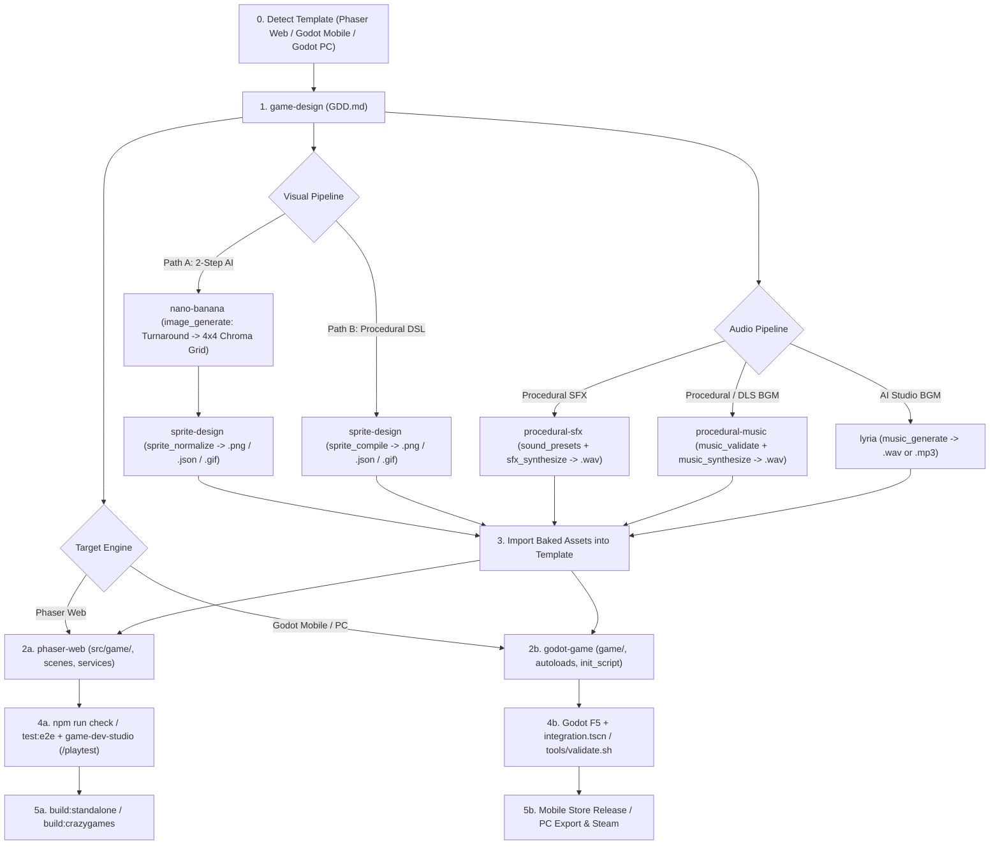

# Vibe Game Developer: 2D Game Studio Router

Orchestrate end-to-end 2D game development across the bundled `agy-game-studio` skills, the 10-tool `game-studio` Go MCP server, and the **Game Dev Studio** Playtest panel for **Phaser Web**, **Godot Mobile**, and **Godot PC** templates.

> [!NOTE]
> **Genre-agnostic and modular design**:
> Every skill in this plugin works for any 2D genre—top-down RPGs, bullet-heavens, shmups, `2:1` isometric tactics, roguelike deckbuilders, grid or physics puzzles, visual novels, rhythm games, and side-scrolling platformers. Never assume side-scrolling gravity or a single asset pipeline. Activate only the companion skills needed for the current task, and combine procedural DSL tools (`sprite-design`, `procedural-sfx`, `procedural-music`) with generative media tools (`nano-banana`, `lyria`) as needed.

---

## Step 0: Identify the project template

Always check the workspace before designing, writing code, or placing assets. The game repository's own `AGENTS.md`, pinned toolchain versions, and docs take precedence over generic advice.

| Template | Target Platforms | Detection Signals in Workspace | Primary GDD Location | Starter Repo (`docs/template/APPLYING.md`) |
| :--- | :--- | :--- | :--- | :--- |
| **Phaser Web** | Browser (standalone, CrazyGames, itch.io iframe) | `package.json` with `phaser` dependency + `src/config/game.ts`, `src/game/`, `docs/game/README.md` | `docs/game/GDD.md` | [harpuria/phaser-web-template](https://github.com/harpuria/phaser-web-template) |
| **Godot Mobile** | Android, iOS (Google Play, ONE store, App Store) | `project.godot` + `docs/CODEBASE_MAP.md` + `services/ads/` or `services/billing/` + `ui/common/safe_area.gd` | `docs/GDD.md` | [harpuria/godot-mobile-template](https://github.com/harpuria/godot-mobile-template) |
| **Godot PC** | Windows, macOS, Linux, Steam Deck (standalone, itch.io, Steam) | `project.godot` + `docs/CODEBASE_MAP.md` + `autoload/window_manager.gd` + `autoload/input_manager.gd` + `tools/validate.sh` | `docs/GDD.md` | [harpuria/godot-pc-template](https://github.com/harpuria/godot-pc-template) |

- **Existing game (including renamed forks)**: Read `AGENTS.md`, `docs/game/README.md` (Phaser) or `docs/CODEBASE_MAP.md` (Godot), and the recorded template source/version before editing.
- **New game or template upgrade**: Follow the chosen template's `docs/template/APPLYING.md`. If target platforms overlap and cannot be inferred from the workspace, ask the user before scaffolding.

---

## Bundled skill ecosystem (10 plugin skills)

`agy-game-studio` bundles `vibe-game-developer` alongside 9 specialized companion skills:

| User Intent / Task | Target Skill | Role, MCP Tools & Integration |
| :--- | :--- | :--- |
| **Game design and GDD creation** | `game-design` | **Game Designer**: Runs one-decision-at-a-time discovery across any 2D genre, locks visual and audio pipelines, and writes `docs/game/GDD.md` (Phaser) or `docs/GDD.md` (Godot). |
| **Phaser Web implementation** | `phaser-web` | **Phaser Architect**: Builds scenes, `MoveInput`, Arcade Physics, pooling, `AudioService`, `Store<T>` saves, localized `strings.ts`, and standalone/CrazyGames builds. |
| **Godot Mobile & PC implementation** | `godot-game` | **Godot Architect**: Builds GDScript scenes under `game/`, `app/init_script` hooks, `SaveManager`/`AudioManager`/`SceneManager`, mobile ads/billing/safe-area, PC input rebinding/windowing/store, and headless validation. |
| **Sprites, tilesets, and animation** | `sprite-design` | **2D Technical Artist**: Normalizes AI grids (`sprite_normalize`), compiles `.sprite` SDF/pixel DSL (`sprite_compile`), inspects `.sprite`/`.aseprite`/`.png` sheets (`sprite_inspect`), and extracts shading ramps (`sprite_extract_palette`). |
| **Generative art and sprite grids** | `nano-banana` | **AI Visual Artist**: Calls `image_generate` (`nano-banana-2.1`, `nano-banana-2`, `nano-banana-2-lite`, `nano-banana-pro`) for character turnaround sheets, `4x4` chroma-key animation grids, `4:1` parallax layers, portraits, and cards. |
| **Procedural SFX (`.sfx`)** | `procedural-sfx` | **SFX Designer**: Lists built-in archetypes (`sound_presets`) and synthesizes 16-bit 44.1 kHz stereo WAV cues (`sfx_synthesize`) with acoustic QA validation. |
| **Procedural BGM (`.music`)** | `procedural-music` | **Procedural Composer**: Validates music theory and barlines (`music_validate`) and renders polyphonic `.music` scores (`music_synthesize`, SEGA YM2612/PSG or macOS `apple: true` CoreAudio) to `.wav` and stems. |
| **Generative AI music** | `lyria` | **AI Music Composer**: Calls `music_generate` (`lyria-3.5`, `lyria-3-clip-preview`, `lyria-3-pro-preview`) for 44.1 kHz stereo `.wav` or `.mp3` tracks, vocal songs with lyrics (`outLyricsPath`), and image-to-music cues. |
| **Phaser Playtest panel** | `game-dev-studio` | **Studio Playtest Launcher**: Starts and connects a Phaser Web game from the panel's **Run game** button and surfaces `[Game Dev Studio](sidecar://agy-game-studio/studio/playtest)` for 10s DVR capture, bug annotation, and GIF reports. |

---

## Bundled `game-studio` MCP tools and Playtest panel

The plugin runs the headless Go `game-studio` MCP server (`mcp_config.json`) with **10 tools** alongside the **Game Dev Studio** Playtest side panel:

| Surface | Tools / Panel | What They Do |
| :--- | :--- | :--- |
| **`game-studio` MCP Audio** | `sound_presets`, `sfx_synthesize`, `music_validate`, `music_synthesize`, `music_generate` | Lists SFX/music presets, validates `.music` scores, renders `.sfx` and `.music` scripts to 44.1 kHz stereo `.wav` and stems, and generates AI `.wav`/`.mp3` tracks with Lyria. |
| **`game-studio` MCP Sprite & Image** | `sprite_inspect`, `sprite_compile`, `sprite_normalize`, `sprite_extract_palette`, `image_generate` | Generates AI art and `4x4` chroma grids with Nano Banana, strips chroma backgrounds and packs `.png`/`.json`/`.aseprite`/`.sprite`/`.gif`, compiles `.sprite` DSL, and extracts 4-step shading ramps. |
| **Game Dev Studio (`/playtest`)** | `sidecar://agy-game-studio/studio/playtest` | Starts a **Phaser Web** game in one click (**Run game**) and connects to it, with a 10-second DVR rewind buffer, visual bug annotation (`F8` or `` ` ``), and PNG/GIF export to chat. |

---

## Architecture and workflow composition

---

## Asset pipeline decision rules

Follow the pipeline recorded in `GDD.md`, or align with the user first. Only produce assets that the current milestone actually uses—avoid speculative asset batches. Always resolve MCP input and output paths from the game repository root and pass **absolute paths** to `game-studio` MCP tools.

### Sprites, visuals, and runtime VFX

Confirm animation tags, camera projection (`2D side-profile`, `3/4 top-down`, `2:1 isometric`, or `front-facing ortho`), frame resolution (`256x256+` 2D HD vs. `32x32`/`64x64` pixel art), and production path first:

- **Path A: Two-step AI character sheet to sprite grid (`nano-banana` + `sprite-design`)**:
  - Best for expressive heroes, bosses, NPCs, creatures, and isometric units with 4 or more motion tags.
  - **Step 1**: Call `image_generate` (`model: "nano-banana-2.1"`) to create a turnaround sheet with matching camera projection, clear limb separation, and a 4-step color swatch bar.
  - **Step 2**: Pass that sheet in `inputImages` to `image_generate` to create a uniform `4x4` animation grid on a `#00FF00` or `#FF00FF` chroma-key background with at least 15% empty cell margins. Then call `sprite_normalize` to strip chroma backgrounds, center and ground frames, and export `.png`, `.json`, `.aseprite`, `.sprite`, and preview GIFs.
- **Path B: Pure-code procedural `.sprite` DSL (`sprite-design`)**:
  - Best for crisp geometric enemies, projectiles, pickups, props, and seamless tilesets.
  - Author `.sprite` files using Z-ordered `part` blocks, SDF/pixel primitives, palettes/ramps (or ramps extracted via `sprite_extract_palette`), and `tag`/`pose` animations. Call `sprite_compile` to validate QA metrics and export baked `.png`, `.json`, `.aseprite`, and preview GIFs.
- **Backgrounds, portraits, and runtime VFX (`nano-banana` + `phaser-web` / `godot-game`)**:
  - Use `image_generate` (`aspectRatio: "4:1"` for seamless parallax layers, `"1:1"` or `"3:4"` for portraits and cards).
  - Implement runtime particles, tweens, screen shake, hit-stop, and shaders inside the target engine skill (`phaser-web` or `godot-game`).
- **Inspect baked sprites**: Review generated `outPreviewPath` PNGs and `outGifDir` animations (or `sprite_inspect` QA metrics) before wiring them into scenes.

### Audio and music

- **Choose `procedural-sfx`**: Call `sound_presets` to inspect the 18 built-in archetypes, author `.sfx` scripts, and call `sfx_synthesize` with `outWavPath` to bake click-free 16-bit 44.1 kHz stereo `.wav` cues for jumps, hits, pickups, lasers, and UI ticks.
- **Choose `procedural-music`**: Compose polyphonic `.music` scores (`8` to `12+` tracks, verified `|` barlines, `~` cross-bar ties). Run `music_validate` for music-theory and duration checks, then call `music_synthesize` (pure-Go YM2612 + SN76489, or `apple: true` on macOS CoreAudio) with `outWavPath` to bake sample-exact loopable `.wav` music.
- **Choose `lyria`**: Call `music_generate` (`lyria-3.5` default for `.wav` or `.mp3`, `lyria-3-clip-preview` for 30s `.mp3` clips, `lyria-3-pro-preview` for long `.mp3` songs) for orchestral, vocal, or image-inspired tracks.
- **Looping format rule**: Prefer **`.wav`** (`music_synthesize` or `lyria-3.5` with `apiMode: "interactions"`) for gapless gameplay BGM loops. MP3 encoder priming padding causes audible seams at loop boundaries in both browsers and Godot.

### Wiring baked assets into each template

- **Phaser Web**: Place baked `.png` and `.wav` files under `public/assets/`, declare keys in `src/game/assets.ts`, queue them in `queueAssets`, load uniform sheets with `load.spritesheet(..., { frameWidth, frameHeight })`, register animations with `anims.generateFrameNumbers`, and play audio through `AudioService`.
- **Godot Mobile & PC**: Place baked `.png` and `.wav` files under `game/assets/` (or the game's asset folder), let Godot import them (`--editor --import --quit`), slice uniform sheets in `SpriteFrames` for `AnimatedSprite2D` matching tag frame order and FPS, enable loop on BGM `.wav.import` if looping, and play audio through `AudioManager`.

### Fail-fast credential policy

`image_generate` and `music_generate` authenticate using Vertex AI / Gemini Enterprise Application Default Credentials (`GOOGLE_CLOUD_PROJECT`, `GOOGLE_CLOUD_LOCATION="global"`, `GOOGLE_GENAI_USE_ENTERPRISE="true"`, `gcloud auth application-default login`) or `GEMINI_API_KEY` / `GOOGLE_API_KEY`. If authentication or validation fails, **stop immediately**, report the exact error and remediation steps, and never fabricate mock assets or silently switch models.

---

## End-to-end lifecycle and stage gates

Work through the stages needed for the user's request and verify each gate before advancing:

1. **Design (`game-design`)**
   - *Gate*: Core loop, camera projection, controls, win/loss rules, visual/audio pipeline, and save schema are agreed and written to `docs/game/GDD.md` (Phaser) or `docs/GDD.md` (Godot).
2. **Project setup & playable slice (`phaser-web` or `godot-game`)**
   - *Gate*: First playable end-to-end round works (start -> core action -> win/loss -> restart), game rules stay inside `src/game/` (Phaser) or `game/` (Godot), and template services handle saves, settings, input, pause, and audio.
3. **Visual & audio assets (`sprite-design`, `nano-banana`, `procedural-sfx`, `procedural-music`, `lyria`)**
   - *Gate*: Assets are baked via MCP tools, visually/acoustically checked, imported into the template, and verified in the live target scene (animations, scale, loop boundaries, SFX cooldowns).
4. **Verification & playtest (`phaser-web` + `game-dev-studio`, or `godot-game`)**
   - **Phaser Web**: Run `npm run check`; run `npm run test:e2e` for UI/input changes (`E2E_PREVIEW=1 npm run test:e2e` for build/service changes). For interactive playtesting or bug capture, surface `[Game Dev Studio](sidecar://agy-game-studio/studio/playtest)` via `game-dev-studio`.
   - **Godot Mobile**: Run `godot --headless --path . --editor --import --quit` and the affected `tests/integration.tscn` scenarios (default, `--disabled`, `--native`), plus `python3 tools/check_docs.py` if docs changed. Run the scene in the editor (`F5`) or `godot --path .`.
   - **Godot PC**: Run `bash tools/validate.sh` (set `GODOT` if outside `PATH`) and inspect both summary and logs. Run the scene in the editor (`F5`) or `godot --path .` (`--capture` for GUI verification).
   - *Reporting rule*: Explicitly separate checks that actually ran from unverified browsers, OS binaries, physical mobile devices, or live store backends. Never claim device or store verification from desktop/headless tests alone.
5. **Distribution & release (follow template release docs)**
   - **Phaser Web**: `npm run build:standalone` for self-hosting; `npm run build:crazygames` + `docs/CRAZYGAMES.md` (+ `npm run test:sdk` when verifying CDN SDK) for CrazyGames.
   - **Godot Mobile**: Bump `build_number` in `config/game.cfg`, run `godot --headless --path . --script res://tools/configure.gd`, and follow `docs/STORE_RELEASE.md`, `docs/ANDROID_SERVICES.md`, and `docs/ONESTORE.md` (keep one store per Android export preset).
   - **Godot PC**: Configure `config/game.cfg` (`exclude_demo`, `steam_only_filter`), run `godot --headless --path . --script res://tools/configure.gd`, and follow `docs/DISTRIBUTION.md` and `docs/STEAM.md`.
